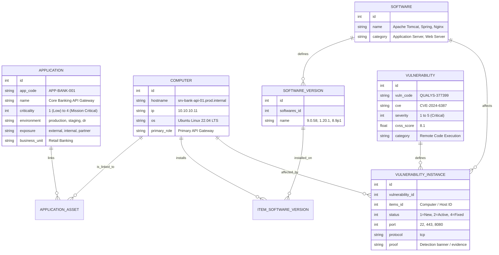

# CMDB & Vulnerability Management Mock Dataset

This directory contains a complete, enterprise-grade mock dataset covering **Applications**, **Servers**, **Software Components**, and **Vulnerabilities**. It is designed to match standard enterprise CMDB schemas and the GLPI Vulnerability Management data model, provided in multiple formats (**CSV**, **JSON**, and **SQL**), with ready-to-run import and generation tooling.

---

## 📁 Directory Structure

```text
mock_data/
├── csv/
│   ├── applications.csv                 # Business applications & criticalities
│   ├── servers.csv                      # Infrastructure servers & network info
│   ├── software_components.csv         # Middleware, libraries, runtimes, versions
│   ├── application_servers.csv          # Relational link: Application <-> Servers
│   ├── server_software.csv              # Relational link: Server <-> Installed Software
│   ├── vulnerabilities.csv              # KnowledgeBase CVE definitions & CVSS scores
│   ├── vulnerability_findings.csv       # Per-asset detection instances & proofs
│   └── vulnerability_scan_flat_export.csv # Qualys/Nessus-style flat scanner export
├── json/
│   ├── applications.json                # API-ready applications list
│   ├── servers.json                     # API-ready servers list
│   ├── software_components.json         # API-ready software catalog
│   ├── application_servers.json         # Many-to-many application-server links
│   ├── server_software.json             # Installed packages per server
│   ├── vulnerabilities.json             # KnowledgeBase CVE catalogue
│   ├── vulnerability_findings.json      # Findings with status and port details
│   ├── vulnerability_scan_flat_export.json # Flat scanner export records
│   └── unified_cmdb_risk_graph.json    # Complete hierarchical relational graph
├── sql/
│   └── seed_glpi_mock_data.sql          # Ready-to-execute SQL seeding script for GLPI
└── scripts/
    ├── generate_mock_data.py            # Regenerate or customize mock dataset
    └── import_data.py                   # REST API client & importer
```

---

## 🏗️ Data Architecture & Relationships



---

## 📊 Summary of Mock Data Contents

### 1. Applications (8 Applications)
| Code | Name | Criticality | Env | Exposure | Business Unit |
| :--- | :--- | :--- | :--- | :--- | :--- |
| `APP-BANK-001` | Core Banking API Gateway | **Tier 1 (Mission Critical)** | Prod | Partner | Retail & Digital Banking |
| `APP-ECOM-002` | Customer E-Commerce Storefront | **Tier 1 (Mission Critical)** | Prod | External | Digital Commerce |
| `APP-PAY-003` | Global Payment Settlement Engine | **Tier 1 (Mission Critical)** | Prod | External | Payment Services |
| `APP-DATA-004` | Real-Time Fraud & Risk Analytics Pipeline | **Tier 2 (High)** | Prod | Internal | Risk Management & Compliance |
| `APP-HR-005` | Human Resources & Payroll Hub | **Tier 3 (Medium)** | Prod | Internal | People & Organization |
| `APP-OPS-006` | DevOps CI/CD Automation Platform | **Tier 2 (High)** | Prod | Internal | Engineering Platform |
| `APP-STG-007` | Customer Support Staging Environment | **Tier 4 (Low)** | Staging | Internal | Customer Support |
| `APP-DR-008` | Disaster Recovery Standby Core | **Tier 1 (Mission Critical)** | DR | Internal | Business Continuity |

### 2. Infrastructure Servers (15 Hosts)
- **Banking Cluster:** `srv-bank-api-01`, `srv-bank-api-02`, `srv-bank-db-01`
- **E-Commerce Cluster:** `srv-ecom-web-01`, `srv-ecom-web-02`, `srv-ecom-app-01`, `srv-ecom-cache-01`
- **PCI Payment Cluster:** `srv-pay-proc-01`, `srv-pay-hsm-01`
- **Big Data Cluster:** `srv-data-spark-01`, `srv-data-worker-01`
- **Enterprise & Corporate:** `srv-hr-app-01`, `srv-ops-ci-01`, `srv-sup-stage-01`, `srv-dr-core-01`

### 3. Software Components (13 Softwares, 19 Versions)
- **Web & App Servers:** Apache Tomcat (9.0.58, 10.1.18), Nginx (1.20.1, 1.24.0), Apache HTTP Server (2.4.49)
- **Frameworks & Runtimes:** Spring Framework (5.3.18, 6.0.14), Node.js (16.14.0), Apache Spark (3.2.0)
- **Libraries & Utilities:** Apache Log4j (2.14.1, 2.17.1), OpenSSL (1.1.1k, 3.0.12), OpenSSH (8.9p1, 9.8p1)
- **Databases & Messaging:** PostgreSQL (14.8), Redis (6.2.5), RabbitMQ (3.9.15), Jenkins (2.441)

### 4. Vulnerabilities & Findings (9 CVEs, 12 Findings)
- **CVE-2024-6387 (regreSSHion):** OpenSSH race condition unauthenticated root RCE (CVSS 8.1, Sev 5) on `srv-bank-api-01`, `srv-bank-api-02`.
- **CVE-2021-44228 (Log4Shell):** Apache Log4j JNDI RCE (CVSS 10.0, Sev 5) on `srv-ecom-app-01`.
- **CVE-2022-22965 (Spring4Shell):** Spring Framework RCE via parameter binding (CVSS 9.8, Sev 5) on `srv-bank-api-01`, `srv-bank-api-02`.
- **CVE-2023-44487 (HTTP/2 Rapid Reset):** Stream cancellation DoS (CVSS 7.5, Sev 4) on `srv-ecom-web-01`, `srv-ecom-web-02`.
- **CVE-2022-3602 (OpenSSL):** X.509 buffer overflow (CVSS 7.5, Sev 4) on `srv-pay-proc-01`.
- **CVE-2024-23897 (Jenkins CLI):** Arbitrary file read & elevation (CVSS 9.8, Sev 5) on `srv-ops-ci-01`.
- **CVE-2022-33891 (Apache Spark):** ACL command injection (CVSS 8.8, Sev 4) on `srv-data-spark-01`.
- **CVE-2021-41773 (Apache HTTP Server):** Path traversal (CVSS 7.5, Sev 4) on `srv-hr-app-01` (marked as Fixed).
- **CVE-2023-30533 (Node.js):** Prototype pollution (CVSS 6.5, Sev 3) on `srv-sup-stage-01` (marked as Ignored/Accepted Risk).

---

## 🚀 How to Use the Mock Data

### Method 1: Instant SQL Seeding (Recommended for Local GLPI Docker)
If you are running GLPI in Docker:
```bash
docker compose exec -T db mariadb -u glpi -pglpi_secret_password_2026 glpi < mock_data/sql/seed_glpi_mock_data.sql
```
*Instantly populates all tables with zero manual clicks.*

---

### Method 2: GLPI REST API Import
Ensure the REST API is enabled in **Setup > General > API**, then run:
```bash
python3 mock_data/scripts/import_data.py --api-import \
    --api-url "http://localhost:8080/apirest.php" \
    --username "glpi" \
    --password "glpi"
```

---

### Method 3: Flat Vulnerability Scanner CSV Import (Qualys / Nessus Style)
If you want to simulate scanning exports, use `mock_data/csv/vulnerability_scan_flat_export.csv`.

You can pipe it to the import script documented in the plugin's README:
```bash
docker compose exec -i glpi php /var/www/glpi/plugins/vulnerabilitymanagement/import_csv.php < mock_data/csv/vulnerability_scan_flat_export.csv
```

---

## 🔄 Mapping Guide for When You Provide Actual Data

When you are ready to provide your actual data via **CSV** or **API**, refer to these mapping specifications:

### 1. Applications Mapping
| Field | CSV Header | REST API Key | Description / Allowed Values |
| :--- | :--- | :--- | :--- |
| **Application Name** | `name` | `name` | Full name of the application |
| **CMDB / App Code** | `app_code` | `app_code` | Unique identifier (e.g. `APP-101`) |
| **Criticality Tier** | `criticality` | `criticality` | `4` (Mission Critical), `3` (High), `2` (Medium), `1` (Low) |
| **Environment** | `environment` | `environment` | `production`, `staging`, `development`, `dr` |
| **Network Exposure**| `exposure` | `exposure` | `internal`, `external`, `partner` |
| **Business Unit** | `business_unit`| `business_unit`| Division / Business owner department |
| **Description** | `description` | `description` | Architectural / Business description |

### 2. Servers / Assets Mapping
| Field | CSV Header | REST API Target | Description / Allowed Values |
| :--- | :--- | :--- | :--- |
| **Hostname** | `hostname` | `Computer.name` | FQDN or server hostname (primary lookup key) |
| **IP Address** | `ip` | `IPAddress.name` | Primary IPv4 / IPv6 address |
| **OS Name** | `os` | `OperatingSystem.name` | e.g. `Ubuntu Linux`, `RHEL`, `Debian`, `Windows` |
| **OS Version** | `os_version` | `OperatingSystemVersion.name` | e.g. `22.04 LTS`, `9.2` |
| **Role / Comment** | `primary_role` | `Computer.comment` | Functional role in application architecture |

### 3. Software Components Mapping
| Field | CSV Header | REST API Target | Description |
| :--- | :--- | :--- | :--- |
| **Software Name** | `name` | `Software.name` | e.g. `Apache Tomcat`, `Nginx`, `OpenSSL` |
| **Version** | `version` | `SoftwareVersion.name`| e.g. `9.0.58`, `1.20.1` |
| **Installed Host**| `hostname` | `Item_SoftwareVersion`| Maps software version to specific server host |

### 4. Vulnerabilities & Findings Mapping
| Field | CSV Header | REST API Target | Description |
| :--- | :--- | :--- | :--- |
| **Vulnerability ID** | `qid` / `vuln_code` | `Vulnerability.vuln_code`| Unique vulnerability scanner code |
| **CVE Number** | `cve` | `Vulnerability.cve` | Standard CVE (e.g. `CVE-2024-6387`) |
| **Title / Name** | `title` / `name` | `Vulnerability.name` | Vulnerability title |
| **Severity** | `severity` | `Vulnerability.severity` | `1` (Minimal) to `5` (Urgent / Critical) |
| **CVSS Score** | `cvss` / `cvss_score`| `Vulnerability.cvss_score`| Decimal float `0.0` to `10.0` |
| **Available Exploit**| `exploit_status` | `Vulnerability.exploit_status`| `0`=None, `1`=Public PoC, `2`=Weaponized, `3`=Actively Exploited (CISA KEV) |
| **CISA KEV Flag** | `cisa_kev` | `Vulnerability.cisa_kev` | `1` if listed on CISA Known Exploited Vulns, `0` otherwise |
| **Exploit Frameworks**| `exploit_frameworks`| `Vulnerability.exploit_frameworks`| e.g. `Metasploit, Core Impact, Exploit-DB, CISA KEV` |
| **Exposition Status**| `exposure` | `VulnerabilityInstance.exposure` | `external` (Internet-Facing), `partner`, `internal` |
| **Exploitability** | `exploitability_label` | Calculated | Composite Risk (`Critical`, `High`, `Medium`, `Low`) based on Exploit + Exposure |
| **Status** | `status` | `VulnerabilityInstance.status`| `1`=New, `2`=Active, `3`=Re-opened, `4`=Fixed, `5`=Ignored |
| **Port & Protocol**| `port`, `protocol` | `port`, `protocol` | Network port (e.g. `443`, `22`) & `tcp`/`udp`/`local` |
| **Proof / Banner** | `results` / `proof` | `VulnerabilityInstance.proof` | Scanner detection evidence |

---

## 🎯 Exploitability Rating Matrix (Exploit Availability × Exposition)

The plugin and dataset dynamically score threat severity by correlating **Available Exploit** against **Network Exposition**:

| Available Exploit | Internet-Facing (`external`) | Partner / Extranet (`partner`) | Internal Network (`internal`) |
| :--- | :---: | :---: | :---: |
| **Actively Exploited (CISA KEV)** | 🔴 **Critical** *(Imminent Threat)* | 🟠 **High** | 🟠 **High** *(Lateral Movement Threat)* |
| **Weaponized (Metasploit / Exploit Kit)** | 🔴 **Critical** | 🟠 **High** | 🟠 **High** |
| **Public Proof of Concept (PoC)** | 🟠 **High** | 🟡 **Medium** | 🟡 **Medium** |
| **None / Theoretical** | 🟡 **Medium** *(Attack Surface Exposure)* | ⚪ **Low** | ⚪ **Low** |


